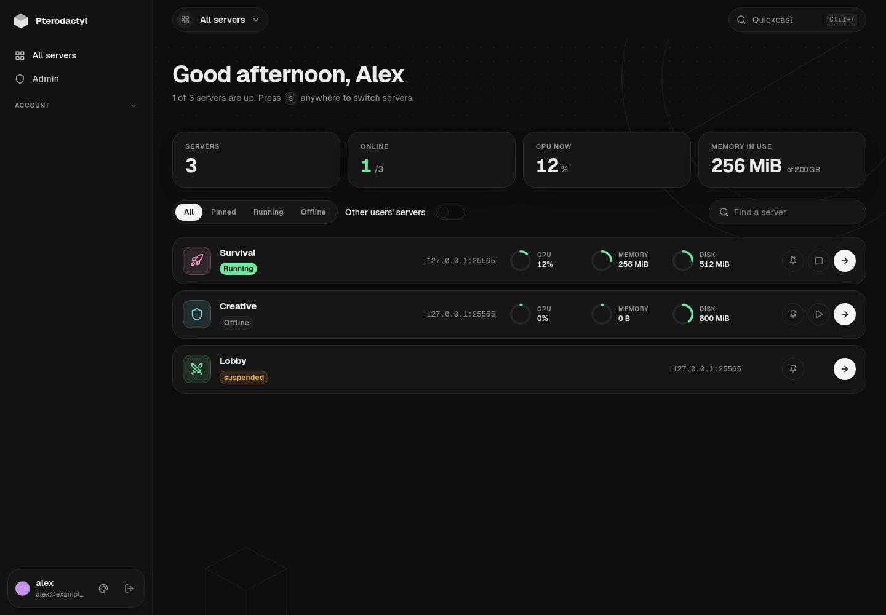
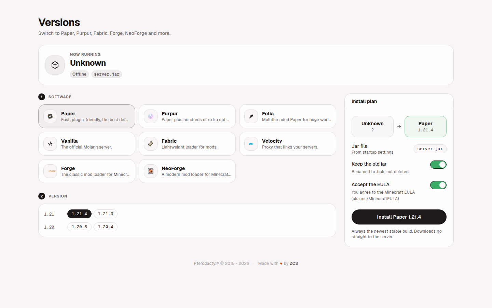
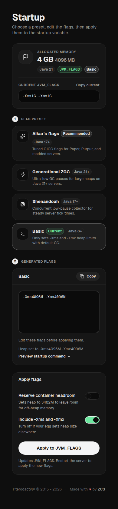

# Obsidian for Pterodactyl

Obsidian is a theme and Minecraft server toolkit for Pterodactyl Panel v2. It uses the panel's native theme and extension APIs.

<p>
  <a href="https://github.com/Zain-Abusal/Ptero-Theme-Obsidian/actions/workflows/ci.yml"><picture><source media="(prefers-color-scheme: dark)" srcset="https://shieldcn.dev/github/ci/Zain-Abusal/Ptero-Theme-Obsidian.svg?workflow=ci.yml&amp;branch=main&amp;mode=dark"></picture></a>
  <a href="https://github.com/Zain-Abusal/Ptero-Theme-Obsidian/releases/latest"><picture><source media="(prefers-color-scheme: dark)" srcset="https://shieldcn.dev/github/release/Zain-Abusal/Ptero-Theme-Obsidian/stable.svg?mode=dark"></picture></a>
  <a href="https://github.com/Zain-Abusal/Ptero-Theme-Obsidian/stargazers"><picture><source media="(prefers-color-scheme: dark)" srcset="https://shieldcn.dev/github/stars/Zain-Abusal/Ptero-Theme-Obsidian.svg?mode=dark"></picture></a>
  <a href="https://github.com/Zain-Abusal/Ptero-Theme-Obsidian/issues"><picture><source media="(prefers-color-scheme: dark)" srcset="https://shieldcn.dev/github/open-issues/Zain-Abusal/Ptero-Theme-Obsidian.svg?mode=dark"></picture></a>
  <a href="https://github.com/Zain-Abusal/Ptero-Theme-Obsidian/pulls"><picture><source media="(prefers-color-scheme: dark)" srcset="https://shieldcn.dev/github/open-prs/Zain-Abusal/Ptero-Theme-Obsidian.svg?mode=dark"></picture></a>
</p>

## Preview

These previews use sample server data. Select any image to open it at full size.

### Dashboard · desktop · dark mode

<p align="center">
  <a href="docs/images/dashboard-dark.png"></a>
</p>

### Software selector · desktop · light mode

<p align="center">
  <a href="docs/images/versions-light.png"></a>
</p>

### JVM flags · phone · dark mode

<p align="center">
  <a href="docs/images/startup-mobile-dark.png"></a>
</p>

## Install

1. Download the `.pteroext` file from [Releases](https://github.com/Zain-Abusal/Ptero-Theme-Obsidian/releases/latest).
2. Upload it under **Admin > Themes**, or run:

   ```sh
   php artisan p:extension:install obsidian-VERSION.pteroext --enable
   php artisan p:theme:activate obsidian
   ```

To preview the theme for your account only, choose **Preview for me** under Admin > Themes. To upgrade, install the new file with `--replace`.

## Features

### Panel

- Sidebar navigation grouped by area, a server switcher, Quickcast search, and a dashboard with filters and resource summaries.
- Console search, history, warning and error filters, command suggestions, saved quick commands, and copy or download actions.
- Dark and light schemes with eight surfaces. Users can choose a surface and color scheme.
- Per-server groups, colors, icons, notes, and quick commands.
- Optional announcement or maintenance banner.
- Responsive file editor with adjustable text size and line wrapping.

### Minecraft tools

| Page | Includes |
| --- | --- |
| Players | Online list, whitelist, operators, bans, kicks, and player history |
| Versions | Paper, Purpur, Folia, Vanilla, Fabric, Forge, NeoForge, and Velocity installs |
| Startup | Editable egg variables, Docker image, startup command, and editable JVM flag presets |
| Plugins and mods | Search Modrinth, Hangar, SpigotMC, and CurseForge; install and manage results |
| Packs | Modpacks, datapacks, and resource packs |
| Kits | Install curated plugin bundles and skip plugins already present |
| Properties | `server.properties`, MOTD preview, and Bukkit, Spigot, and Paper YAML editors |
| Worlds | Switch, download, back up, reset, and pre-generate worlds |
| Votifier | Install NuVotifier, select an assigned port, and copy the public key or token |
| Restarts | Schedule daily or weekly restarts with in-game warnings |
| Crash doctor | Analyze the latest crash report or log and show possible fixes |
| Importer | Import worlds, datapacks, jars, and archives from a URL |

Use Pterodactyl's **Network** page to assign and manage allocations. Obsidian does not add a second allocation manager.
The Votifier page can select one of those allocations for the plugin.

Minecraft pages are shown on Minecraft Java servers. Each action uses the panel API and the signed file upload where supported, so panel permissions still apply.

## Settings

Administrators configure Obsidian under **Admin > Themes > Obsidian**.

| Tab | Options |
| --- | --- |
| Branding | Logo, brand name, sign-in tagline, footer text |
| Colours | Primary color, primary text, online color, default surface |
| Layout | Corner radius, density, content width, background decoration, sidebar server card |
| Dashboard | Greeting, totals, server switcher key |
| Integrations | CurseForge API key, live player counts |
| Banner | Visibility, message, style, link, and whether users can dismiss it |

The CurseForge key is available to signed-in users of the panel. Use a key created for this panel. Live player counts send each running server's public address to mcsrvstat.us. Plugin searches use the configured project APIs. Console logs are sent to mclo.gs only when someone chooses Share or Deep analysis.

## Project logos

Software marks are bundled from their project sites and shown as supplied. See [logo sources and usage notes](docs/software-logos.md).

## Develop

The panel SDK workspace is required to build the theme:

```sh
git clone --depth 1 --branch v2.0.0-beta.3 https://github.com/pterodactyl/panel.git panel
(cd panel && npm ci && npm run sdk:generate && npm run sdk:testing)
npm ci
npm run release
```

`npm run release` checks formatting, types, and tests, then builds and packs `release/themes/obsidian-VERSION.pteroext`.
With a local panel, run `php artisan p:extension:dev packages/obsidian --enable --watch` to rebuild on changes.

To add a Minecraft page, add its route and permissions to `packages/obsidian/extension.json`, then create a matching `src/tools/screens/<Name>Screen.tsx`. The theme registers screens from the manifest.

## Release

Update the version in `packages/obsidian/extension.json` and `packages/obsidian/package.json`, then push a matching tag such as `vX.Y.Z`. The release workflow builds and uploads the `.pteroext` file.
